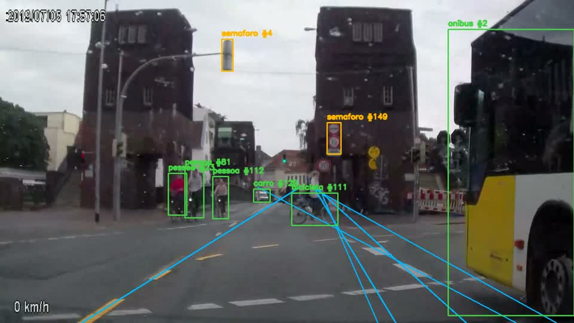
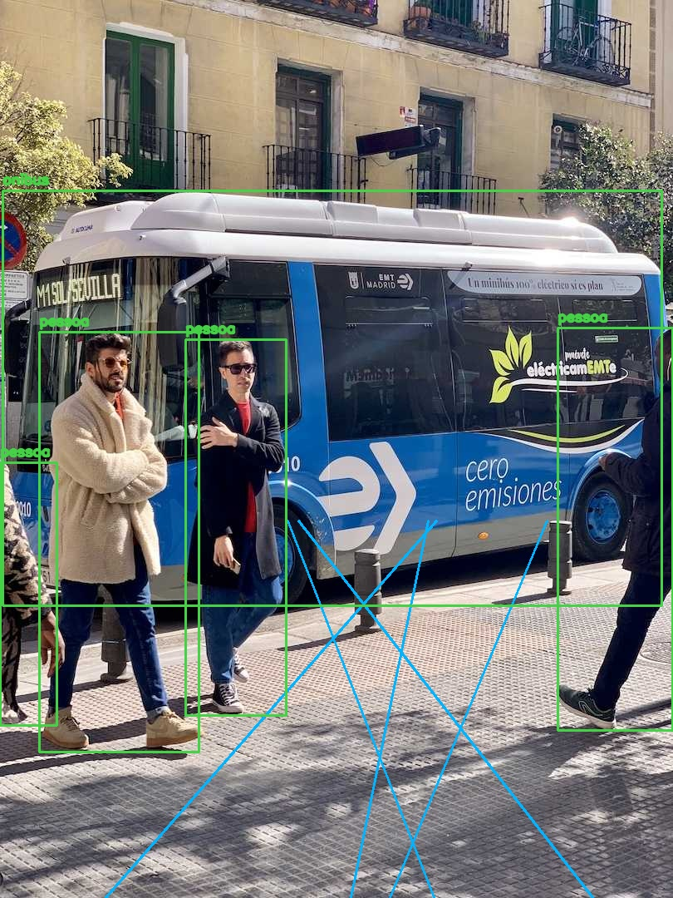

# 4. Testes e validação

Nesta etapa testamos o protótipo desenvolvido até aqui, formado pelo módulo de visão computacional, que detecta e rastreia objetos de trânsito em imagens e vídeos, e pela base de conhecimento em TypeDB, que registra veículos, condutores e equipamentos. Também testamos a integração entre essas duas partes, implementada nesta etapa.

## 4.1 Planejamento dos testes

Os testes foram organizados em três níveis. Os testes de unidade verificam as funções do módulo de visão e a comunicação com o banco usando dados simulados. Os testes de integração verificam a carga de dados, as consultas e as inferências da base de conhecimento, além da ligação entre visão e base. Os testes de sistema executam o protótipo com imagens e um vídeo real de trânsito e avaliam o resultado produzido.

Como entrada, usamos um vídeo de câmera veicular de 18,6 segundos, disponível no Wikimedia Commons sob licença CC BY-SA 4.0, um quadro extraído desse vídeo e uma imagem de demonstração da Ultralytics. A detecção de velocidade, colisão e uso de capacete ficou fora desta etapa, pois ainda não foi implementada.

## 4.2 Casos de teste

| ID | Caso de teste | Resultado esperado |
|---|---|---|
| CT01 | Detecção de objetos em imagem | Identificar carros, pessoas, ônibus e semáforos com a classe e a confiança |
| CT02 | Rastreamento em vídeo | Manter o mesmo identificador para cada objeto ao longo dos quadros |
| CT03 | Estimativa de faixa | Indicar a faixa do veículo quando as marcações estiverem visíveis |
| CT04 | Passagem por sinal | Registrar um evento quando o veículo cruza a linha de um semáforo |
| CT05 | Consultas da base de conhecimento | Retornar os veículos, condutores e equipamentos cadastrados |
| CT06 | Inferência de piloto sem capacete | Atualizar a lista quando um capacete é associado ao piloto |
| CT07 | Integração entre visão e base | Relacionar os veículos detectados aos tipos cadastrados na base |
| CT08 | Desempenho | Processar o vídeo em tempo menor que a sua duração |

## 4.3 Execução

Na primeira execução, a base de conhecimento não iniciava e a análise de vídeo era interrompida no primeiro veículo rastreado. Depois das correções descritas na seção 4.5, os 34 testes automatizados foram aprovados.

| ID | Resultado obtido |
|---|---|
| CT01 | Aprovado |
| CT02 | Aprovado, com 557 quadros analisados |
| CT03 | Aprovado com limitações, descritas na seção 4.5 |
| CT04 | Aprovado nos testes de unidade; no vídeo real, nenhum evento foi gerado |
| CT05 | Aprovado |
| CT06 | Aprovado |
| CT07 | Aprovado: carros e caminhões detectados foram relacionados aos tipos da base |
| CT08 | Aprovado: vídeo de 18,6 s processado em 15,6 s |

## 4.4 Registro das evidências

As imagens anotadas, os relatórios gerados e os registros de execução estão na pasta `evidencias`.

## 4.5 Correção dos problemas

| Problema | Correção |
|---|---|
| A base de conhecimento não iniciava após a reorganização das pastas | Caminho dos arquivos corrigido |
| A análise de vídeo era interrompida por uma variável não definida | Variável corrigida e testes criados para a função |
| Comandos de instalação desatualizados na documentação | Documentação atualizada |
| Dependência do rastreador ausente na lista de instalação | Dependência incluída |

Os testes também mostraram limitações que serão tratadas nas próximas etapas. A estimativa de faixa erra em imagens que não vêm de uma câmera frontal. O rastreador cria um novo identificador quando um objeto some e reaparece, e por isso gerou 123 identificadores no vídeo de teste. Ciclistas são contados como pessoa e como bicicleta. A regra de passagem por sinal não gerou eventos no vídeo real, e o modelo utilizado não detecta capacete.

## 4.6 Validação com usuários

A validação com usuários ainda não se aplica, pois o protótipo funciona apenas por linha de comando e seus resultados são hipóteses visuais, não infrações. Até aqui, o grupo realizou testes exploratórios com vídeos próprios, que ajudaram a definir o que falta implementar. Quando houver uma interface de revisão das ocorrências, a validação será feita com agentes de trânsito e motoristas, que avaliarão as ocorrências apontadas pelo sistema.
