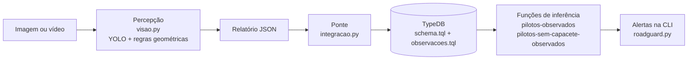

# Plano de testes e validação: SafeRoad / AI RoadGuard

Versão 1.0, 21/10/2026. Cobre a integração entre a percepção visual e a base de conhecimento (opção A: ponte de observações para fatos).

## 1. Objetivo

Verificar que o sistema integrado:

1. detecta objetos de trânsito em imagens e vídeos e descreve o que viu;
2. converte essas observações em fatos tipados na base TypeDB;
3. aplica as regras da base sobre as observações e gera alertas;
4. continua atendendo aos requisitos da atividade 2 (base de conhecimento).

## 2. Arquitetura sob teste



| Item | Arquivo | Papel |
|---|---|---|
| Percepção | `perception/transito/visao.py` | Detecção, faixa, rastreamento, passagem por sinal, associação pessoa–moto |
| Ponte | `perception/transito/integracao.py` | Relatório JSON → `insert` TypeQL; consulta das inferências; CLI `roadguard.py` |
| Base | `knowledge_base/schema.tql` | Ontologia da atividade 2 (inalterada) |
| Extensão | `knowledge_base/observacoes.tql` | Camada de observação: `analise`, `registro-visual`, `sinal`, `passagem-por-sinal`, funções novas |
| Cliente | `perception/transito/client.py`, `application.py` | HTTP do TypeDB, criação e atualização do banco |

### Mapeamento entre visão e base

| Classe da visão | Tipo na base | Observação |
|---|---|---|
| pessoa | `pessoa` | `nome` = "Pessoa observada #ID" |
| carro, moto, caminhão | `carro`, `moto`, `caminhao` | `modelo` = "Moto observada #ID" etc. |
| semáforo, placa de pare | `semaforo`, `placa-pare` (subtipos de `sinal`) | |
| ônibus, bicicleta | `objeto-generico` | A ontologia da atividade 2 não tem esses tipos; adicioná-los mudaria a consulta 07 |
| associação `possivel_conducao` | relação `conducao` | Permite que `pilotos()` da atividade 2 funcione sobre o que foi visto |
| evento `possivel_passagem_visual_por_sinal` | relação `passagem-por-sinal` | Eventos de veículos sem tipo na base (ônibus) são ignorados e contados |

## 3. Requisitos rastreados

| ID | Requisito |
|---|---|
| R01 | Detectar objetos de trânsito e informar a posição no quadro |
| R02 | Estimar a faixa da pista quando houver marcações suficientes |
| R03 | Registrar possível passagem por sinal em vídeo |
| R04 | Associar pessoa e moto como possível condução |
| R05 | Converter o relatório visual em fatos tipados, rejeitando relatórios inválidos |
| R06 | Inferir pilotos e pilotos sem capacete registrado a partir das observações |
| R07 | Registrar cada análise uma única vez e sem misturar análises |
| R08 | Preservar a base da atividade 2 e atualizar bancos criados antes da integração |
| R09 | Oferecer uma CLI integrada com mensagens claras e resultado em JSON |

## 4. Estratégia e níveis de teste

| Nível | O que cobre | Como roda | Depende de |
|---|---|---|---|
| N1 Unitário: visão | Funções geométricas e de regra (`find_signal_events`, `is_probable_rider` etc.) | `pytest`, automático | Nada |
| N2 Unitário: ponte | Geração do `insert`, escape de texto, validação do relatório | `pytest`, automático | Nada |
| N3 Componente: pipeline visual | `analyze_image`/`analyze_video` reais com um **modelo roteirizado** no lugar do YOLO; o relatório gerado precisa ser aceito pela ponte (teste de contrato) | `pytest`, automático | `opencv-python`, `numpy` |
| N4 Integração: base | Ponte + TypeDB real: inferência, idempotência, isolamento, atualização de banco antigo, CLI | `pytest`, automático | TypeDB no Docker (`TYPEDB_TEST_URL`) |
| N5 Sistema: mídia real | `roadguard.py analisar` com YOLO em imagens e vídeos reais | Manual, com roteiro | `ultralytics`, mídia de campo |
| N6 Avaliação do modelo | Precisão e revocação numa amostra rotulada | Manual/semiautomático | Amostra rotulada |
| N7 Validação com usuários | Concordância com os alertas e usabilidade | Sessões com participantes | Participantes |

O modelo roteirizado (N3) isola a lógica do projeto do comportamento do YOLO: os testes ficam determinísticos e rodam em segundos. A qualidade do detector em si é medida separadamente, em N5 e N6.

## 5. Ambiente

| Componente | Versão usada na execução de 21/10/2026 |
|---|---|
| Sistema | Windows 11 Home 10.0.26200 |
| Python | 3.13.3 (o projeto declara suporte a partir da 3.10; a 3.10 não foi testada nesta rodada) |
| TypeDB | 3.13.6 (imagem `typedb/typedb:3.13.6`, `knowledge_base/compose.yaml`) |
| Bibliotecas | pytest 9.1.1, opencv-python 4.14, numpy 2.5, ruff |

Como executar:

```powershell
python -m pip install -r requirements-dev.txt
docker compose -f knowledge_base/compose.yaml up -d
$env:TYPEDB_TEST_URL = "http://127.0.0.1:18000"
python -m pytest -v
```

Sem `TYPEDB_TEST_URL`, os testes N4 são pulados. Sem OpenCV, os testes N3 são pulados.

## 6. Critérios

**Entrada:** o código passa no `ruff check`; o TypeDB responde em `http://127.0.0.1:18000`.

**Saída (aprovação da rodada):**

- 100% dos casos automatizados aprovados;
- nenhum defeito aberto de severidade alta;
- casos manuais N5 executados com evidência registrada;
- resultado de N6 e N7 documentado, mesmo que abaixo da meta, com análise do motivo.

## 7. Casos de teste automatizados

Status da execução de 21/10/2026. Os arquivos estão em `tests/`.

| ID | Objetivo | Req. | Nível | Teste | Status |
|---|---|---|---|---|---|
| CT-01 | Posição no quadro dividida em terços | R01 | N1 | `test_visao.py::FrameGeometryTests::test_position_in_frame_splits_width_in_thirds` | Aprovado |
| CT-02 | Só as classes de trânsito selecionadas viram detecções | R01 | N1 | `test_visao.py::FrameGeometryTests::test_detections_keep_only_selected_classes` | Aprovado |
| CT-03 | Veículo entre limites estimados recebe a faixa correta | R02 | N1 | `test_visao.py::FrameGeometryTests::test_lane_is_assigned_between_estimated_boundaries` | Aprovado |
| CT-04 | Sem limites suficientes, usa a posição no quadro | R02 | N1 | `test_visao.py::FrameGeometryTests::test_lane_is_not_assigned_with_too_few_boundaries` | Aprovado |
| CT-05 | Descrição menciona a faixa estimada | R01 | N1 | `test_visao.py::FrameGeometryTests::test_description_mentions_lane_when_available` | Aprovado |
| CT-06 | Caminhos padrão das saídas | R09 | N1 | `test_visao.py::FrameGeometryTests::test_default_output_paths` | Aprovado |
| CT-07 | Veículo rastreado não derruba a análise (regressão D01) | R03 | N1 | `test_visao.py::SignalEventTests::test_tracked_vehicle_does_not_crash` | Aprovado |
| CT-08 | Veículo descendo e cruzando a altura do sinal gera um único evento | R03 | N1 | `test_visao.py::SignalEventTests::test_vehicle_moving_down_past_signal_creates_one_event` | Aprovado |
| CT-09 | Veículo subindo não gera evento | R03 | N1 | `test_visao.py::SignalEventTests::test_vehicle_moving_up_creates_no_event` | Aprovado |
| CT-10 | Veículo longe do sinal não gera evento | R03 | N1 | `test_visao.py::SignalEventTests::test_vehicle_far_from_signal_creates_no_event` | Aprovado |
| CT-11 | Sinal não visto há mais de 2 s expira | R03 | N1 | `test_visao.py::SignalEventTests::test_old_signals_expire` | Aprovado |
| CT-12 | Pessoa sentada na moto é piloto | R04 | N1 | `test_visao.py::RiderTests::test_person_seated_on_motorcycle_is_rider` | Aprovado |
| CT-13 | Pedestre ao lado da moto não é piloto | R04 | N1 | `test_visao.py::RiderTests::test_pedestrian_beside_motorcycle_is_not_rider` | Aprovado |
| CT-14 | Pedestre à frente da moto não é piloto | R04 | N1 | `test_visao.py::RiderTests::test_pedestrian_in_front_of_motorcycle_is_not_rider` | Aprovado |
| CT-15 | Pessoa acima da moto, sem sobreposição, não é piloto | R04 | N1 | `test_visao.py::RiderTests::test_person_above_without_overlap_is_not_rider` | Aprovado |
| CT-16 | Associação só entre pessoa e moto | R04 | N1 | `test_visao.py::RiderTests::test_rider_pairs_only_match_people_and_motorcycles` | Aprovado |
| CT-17 | Associação um-para-um com mínimo de quadros | R04 | N1 | `test_visao.py::RiderTests::test_select_riders_is_one_to_one_and_requires_frames` | Aprovado |
| CT-18 | Três marcações sintéticas viram três limites de faixa | R02 | N3 | `test_visao_pipeline.py::VisionPipelineTests::test_lane_boundaries_on_synthetic_road` | Aprovado |
| CT-19 | Pipeline de imagem grava a imagem anotada e o relatório aceito pela ponte | R01, R04, R05 | N3 | `test_visao_pipeline.py::VisionPipelineTests::test_image_pipeline_writes_annotated_image_and_report` | Aprovado |
| CT-20 | Pipeline de vídeo rastreia piloto e passagem por placa de pare | R03, R04, R05 | N3 | `test_visao_pipeline.py::VisionPipelineTests::test_video_pipeline_tracks_rider_and_signal_crossing` | Aprovado |
| CT-21 | Arquivos da base encontrados após a reorganização (regressão D02) | R08 | N2 | `test_integracao.py::ProjectLayoutTests::test_knowledge_base_files_are_found` | Aprovado |
| CT-22 | Barras e aspas escapadas no TypeQL | R05 | N2 | `test_integracao.py::TypeQLLiteralTests::test_string_escapes_backslashes_and_quotes` | Aprovado |
| CT-23 | Código da análise estável e dependente do conteúdo | R07 | N2 | `test_integracao.py::TypeQLLiteralTests::test_analysis_code_is_stable_and_depends_on_content` | Aprovado |
| CT-24 | Relatório de imagem vira fatos tipados | R05 | N2 | `test_integracao.py::BuildInsertTests::test_image_report_becomes_typed_facts` | Aprovado |
| CT-25 | Relatório de vídeo liga rastros, eventos e pilotos | R05 | N2 | `test_integracao.py::BuildInsertTests::test_video_report_links_tracks_events_and_riders` | Aprovado |
| CT-26 | Vínculo com classe trocada pelo rastreador é ignorado | R05 | N2 | `test_integracao.py::BuildInsertTests::test_rider_with_swapped_class_is_ignored` | Aprovado |
| CT-27 | Referência a objeto inexistente é rejeitada | R05 | N2 | `test_integracao.py::BuildInsertTests::test_unknown_reference_is_rejected` | Aprovado |
| CT-28 | Relatórios malformados são rejeitados | R05 | N2 | `test_integracao.py::BuildInsertTests::test_malformed_reports_are_rejected` | Aprovado |
| CT-29 | Relatório sem detecções registra só a análise | R05 | N2 | `test_integracao.py::BuildInsertTests::test_report_without_detections_registers_only_the_analysis` | Aprovado |
| CT-30 | Alertas listados na saída | R09 | N2 | `test_integracao.py::DescribeFindingsTests::test_alerts_are_listed` | Aprovado |
| CT-31 | Saída sem alertas | R09 | N2 | `test_integracao.py::DescribeFindingsTests::test_no_alerts` | Aprovado |
| CT-32 | Fatos de vídeo alimentam as regras de inferência | R06 | N4 | `test_integracao_typedb.py::ObservationIntegrationTests::test_video_facts_feed_the_inference_rules` | Aprovado |
| CT-33 | Fatos de imagem alimentam as regras de inferência | R06 | N4 | `test_integracao_typedb.py::ObservationIntegrationTests::test_image_facts_feed_the_inference_rules` | Aprovado |
| CT-34 | Registrar capacete remove o alerta | R06 | N4 | `test_integracao_typedb.py::ObservationIntegrationTests::test_helmet_registration_removes_the_alert` | Aprovado |
| CT-35 | Registrar duas vezes não duplica | R07 | N4 | `test_integracao_typedb.py::ObservationIntegrationTests::test_registering_twice_does_not_duplicate` | Aprovado |
| CT-36 | Análises não se misturam | R07 | N4 | `test_integracao_typedb.py::ObservationIntegrationTests::test_analyses_are_isolated` | Aprovado |
| CT-37 | Texto com aspas e barras é gravado sem alteração | R05 | N4 | `test_integracao_typedb.py::ObservationIntegrationTests::test_text_with_quotes_and_backslashes_is_stored_verbatim` | Aprovado |
| CT-38 | Banco antigo recebe a extensão sem perder dados | R08 | N4 | `test_integracao_typedb.py::ObservationIntegrationTests::test_existing_database_is_upgraded_without_losing_data` | Aprovado |
| CT-39 | CLI registra relatório e salva o resultado | R09 | N4 | `test_integracao_typedb.py::ObservationIntegrationTests::test_cli_registers_report_and_saves_result` | Aprovado |
| CT-40 | CLI informa arquivo inválido | R09 | N4 | `test_integracao_typedb.py::ObservationIntegrationTests::test_cli_reports_invalid_file` | Aprovado |
| CT-41 a CT-47 | Robustez do cliente HTTP (token vazio, resultado truncado, sem reenvio de escrita, commit, erros HTTP e JSON, senha oculta) | R08 | N1 | `test_client.py::ClientTests` (7 testes) | Aprovado |
| CT-48 | Requisitos da atividade 2 | R08 | N4 | `test_integration.py::IntegrationTests::test_activity_requirements` | Aprovado |
| CT-49 | Reinicialização preserva os exemplos | R08 | N4 | `test_integration.py::IntegrationTests::test_initialization_preserves_existing_examples` | Aprovado |
| CT-50 | Inferência muda quando os fatos mudam | R06 | N4 | `test_integration.py::IntegrationTests::test_inference_changes_when_facts_change` | Aprovado |
| CT-51 | Esquema incompatível é preservado | R08 | N4 | `test_integration.py::IntegrationTests::test_incompatible_schema_is_preserved` | Aprovado |

Os dados de entrada de N2 e N4 estão em `tests/fixtures/relatorio_imagem.json` e `tests/fixtures/relatorio_video.json`. Eles seguem o formato produzido pela visão, e os casos CT-19 e CT-20 garantem que esse formato continua compatível com a ponte.

## 8. Casos manuais (N5 a N7)

| ID | Objetivo | Req. | Procedimento | Resultado esperado | Status |
|---|---|---|---|---|---|
| CT-M01 | Imagem real com moto e piloto | R01, R02, R04, R06 | `python perception/roadguard.py analisar imagem <foto> --resultado <evid>/CT-M01.json` | Moto e pessoa detectadas; "Pessoa (detecção X) possivelmente conduz a moto"; alerta de capacete não registrado | Pendente |
| CT-M02 | Vídeo real com moto atravessando cruzamento sinalizado | R03 a R06 | `python perception/roadguard.py analisar video <video> --resultado <evid>/CT-M02.json` | Piloto associado à moto em ≥ 3 quadros; evento de passagem coerente com o vídeo | Pendente |
| CT-M03 | Vídeo sem motos (controle negativo) | R04, R06 | Igual ao CT-M02 | Nenhum piloto e nenhum alerta de capacete | Pendente |
| CT-M04 | Avaliação quantitativa | R01, R04 | Rotular manualmente 50 a 100 quadros (pessoa, moto, carro, sinal; pares piloto–moto) e comparar com a saída | Registrar precisão e revocação por classe e da associação piloto–moto | Pendente |
| CT-M05 | Validação com usuários | R06, R09 | Ver seção 11 | Concordância ≥ 70% com os alertas; SUS ≥ 68 | Pendente |

## 9. Registro de evidências

Cada rodada fica em `docs/testes/evidencias/AAAA-MM-DD/`:

| Arquivo | Conteúdo |
|---|---|
| `pytest.txt` | Saída completa do `pytest -v`, com ambiente e comando |
| `junit.xml` | Mesmo resultado em formato JUnit (pode ser importado em planilhas e ferramentas de CI) |
| `ruff.txt` | Resultado da análise estática |
| `cli_registrar_*.txt` | Saída da CLI integrada sobre os relatórios de referência |
| `resultado_*.json` | Fatos inferidos pela base, salvos pela opção `--resultado` |
| `CT-Mxx_*` | Para casos manuais: relatório JSON, saída da CLI, quadro anotado e anotações do testador |

Os vídeos e fotos usados nos testes ficam fora do repositório, porque são grandes e mostram pessoas. Guarde-os na pasta do grupo e anote aqui de qual arquivo saiu cada evidência. Se alguma imagem for para o texto do TCC, borre rostos e placas.

## 10. Registro de defeitos

| ID | Descrição | Severidade | Como foi encontrado | Correção | Teste de regressão | Status |
|---|---|---|---|---|---|---|
| D01 | `find_signal_events` usava `y1` e `y2` sem defini-los; a análise de vídeo parava com `NameError` assim que um veículo rastreado aparecia | Alta | Revisão de código, confirmada executando a função com uma detecção sintética | `visao.py`: a caixa passa a ser lida como `x1, y1, x2, y2` | CT-07, CT-20 | Corrigido |
| D02 | Após mover as pastas, `PROJECT_ROOT` apontava para `perception/`; `iniciar`, `demonstrar` e `validar` não achavam `schema.tql` | Alta | Revisão de código, confirmada resolvendo o caminho | `application.py`: raiz do projeto e `KNOWLEDGE_BASE_ROOT = knowledge_base/` | CT-21, CT-48 | Corrigido |
| D03 | Os testes não importavam o pacote `transito` a partir da raiz (`ModuleNotFoundError`) | Média | Execução de `python -m unittest` na raiz | `pyproject.toml`: `pythonpath = ["perception"]` para o pytest; `requirements-dev.txt` | Toda a suíte | Corrigido |
| D04 | README com caminhos anteriores à reorganização; pasta `knowlodge base` com erro de digitação e espaço no nome | Baixa | Revisão da documentação | Pasta renomeada para `knowledge_base`; README reescrito; comandos conferidos | Execução dos comandos do README em 21/10/2026 | Corrigido |

Novos defeitos entram nesta tabela com o próximo ID (D05…) e precisam de um teste de regressão antes de serem fechados.

## 11. Validação com usuários (quando aplicável)

- **Participantes:** 5 a 8 pessoas, de preferência com motociclistas e, se possível, agentes de trânsito ou instrutores de autoescola.
- **Material:** 10 trechos curtos de vídeo analisados pelo sistema, com a imagem anotada e a lista de alertas.
- **Tarefas:**
  1. Para cada alerta, marcar "correto", "incorreto" ou "não dá para saber".
  2. Analisar um vídeo novo com a CLI, seguindo só o README.
- **Instrumentos:** taxa de concordância com os alertas; questionário SUS (System Usability Scale, 10 itens); comentários abertos.
- **Metas:** concordância ≥ 70%; SUS ≥ 68 (média de referência da escala).
- **Ética:** termo de consentimento; nenhum dado pessoal dos participantes no repositório; vídeos com rostos e placas borrados.

## 12. Riscos e limitações conhecidas

- **Capacete:** o modelo COCO não detecta capacete. Por isso, todo piloto observado gera o alerta "sem capacete registrado". O alerta significa "capacete não verificado", não "sem capacete". A opção B (detector de capacete) resolve isso.
- **Condução:** a associação pessoa–moto é geométrica. Garupa, pedestre atrás da moto ou troca de ID no rastreador podem gerar vínculos errados. Em vídeo, a exigência de ≥ 3 quadros reduz falsos positivos.
- **Passagem por sinal:** é uma hipótese geométrica para câmera frontal; não confirma infração.
- **Escopo do N3:** o modelo roteirizado testa a lógica do projeto, não a qualidade do YOLO. Essa qualidade só é medida em N5 e N6.
- **Separação de bancos:** as observações vão para o banco `roadguard`; os dados da atividade 2 ficam em `transito`. Assim, a validação da atividade 2 não é afetada por fatos observados.
